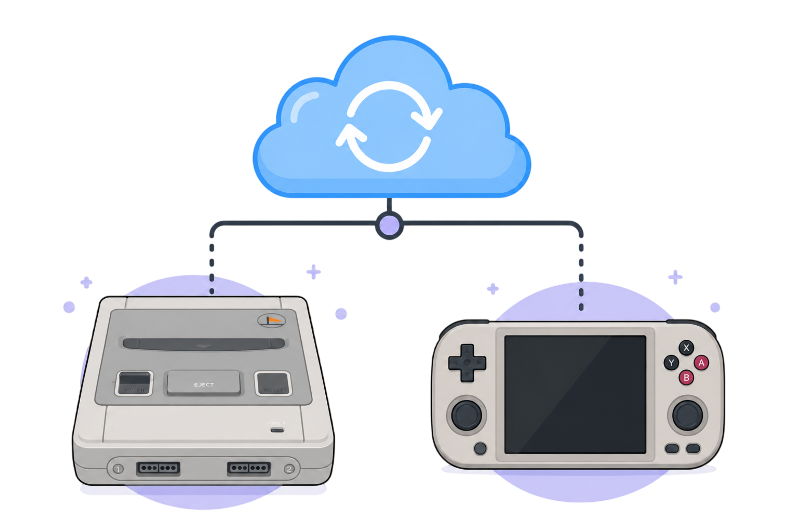
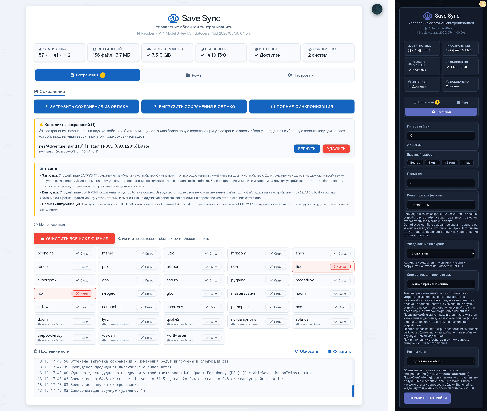
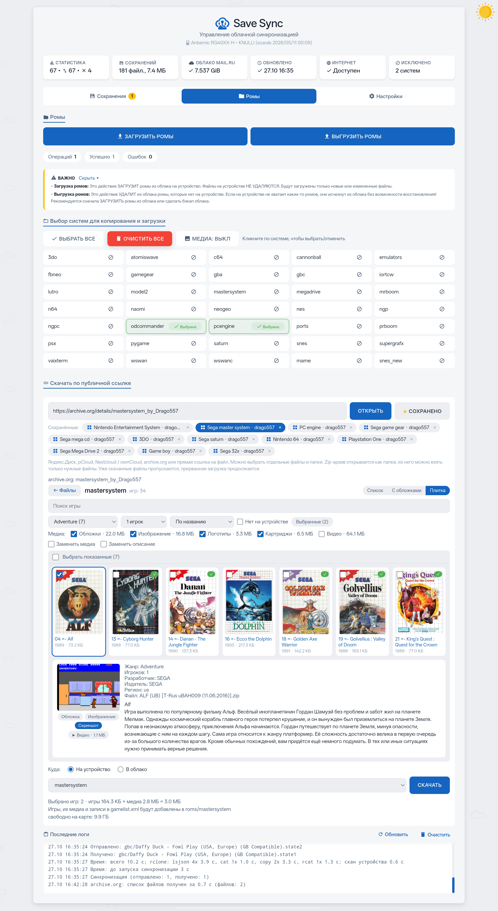
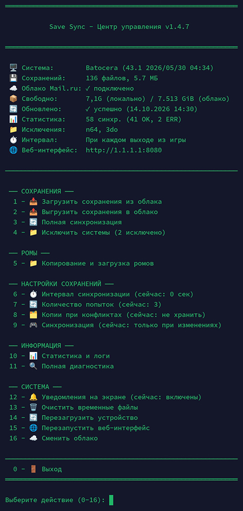
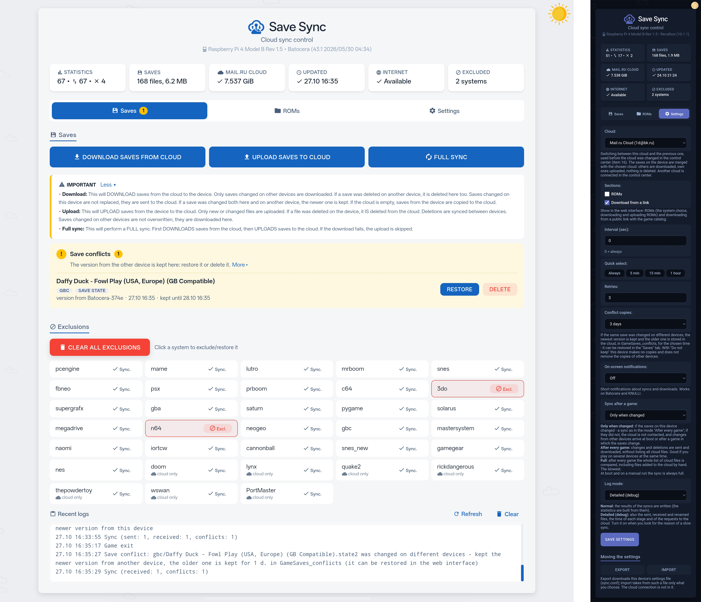
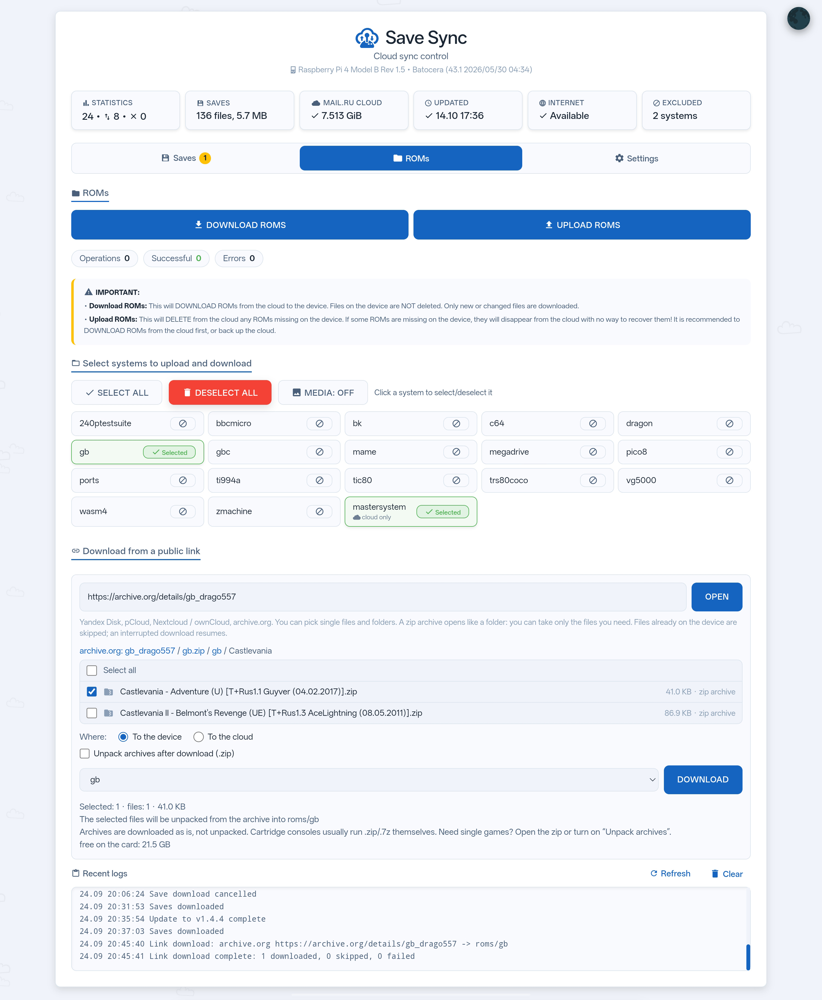
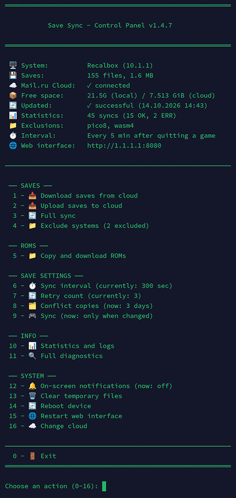

<a name="top"></a>

<p align="center">
  
</p>

<h1 align="center">Save Sync</h1>


**RU** · [English below ↓](#english)

Облачная синхронизация сохранений, копирование и загрузка ромов для ретро-приставок и портативок на **Batocera**, **KNULLI** и **Recalbox**.

Сохранились на одном устройстве — включили другое — продолжаете с того же места. Работает в фоне, не мешает игровому процессу. Управлять можно как с самого устройства (через меню в SSH), так и через веб-интерфейс в браузере.

*Проверено: Batocera 43.1, Recalbox 10.1.1, KNULLI Scarab*

---

## Что умеет

- Автоматически синхронизирует сохранения с облаком по протоколу **WebDAV** (через [rclone](https://rclone.org/))
- Синхронизация при включении и при выходе из игры, всегда в обе стороны: сохранение, изменённое на одном устройстве, уходит в облако и скачивается на остальные
- Удаление тоже синхронизируется — стёрли сохранение на одном устройстве, оно исчезнет из облака и удалится с остальных устройств
- Можно играть на нескольких устройствах сразу: прогресс не перезаписывается вслепую, а если одно и то же сохранение изменили на разных устройствах, остаётся более новая версия, а более старую можно хранить копией в `GameSaves_conflicts` (по умолчанию 3 дня, можно выключить)
- На устройство скачиваются только сохранения тех систем, ромы которых есть на устройстве. Для остальных систем сохранения остаются в облаке и не занимают место на устройстве
- Сохранения портов PortMaster синхронизируются автоматически — только сами сохранения, без данных игры и настроек экрана
- Копирование и загрузка ромов — выгрузить коллекцию в облако или скачать оттуда ромы (и целые системы), которых ещё нет локально
- Загрузка ромов по публичной ссылке (Яндекс.Диск, pCloud, Nextcloud / ownCloud, archive.org) или прямой ссылке на файл — сразу на устройство или в облако: можно выбрать отдельные файлы и папки, взять нужные игры из zip-архива, распаковать .zip / .7z / .rar
- **Каталог игр**: сборку с `gamelist.xml` можно открыть как каталог — с обложками и описаниями, выбрать игры и медиа, а игры сразу появятся в списке с картинками, без скрапинга
- Не нужно постоянно включённое устройство: не требуется, чтобы оба девайса были онлайн одновременно, и не нужен отдельный сервер или NAS — только обычный облачный WebDAV-аккаунт
- Работает с любым числом устройств в любом сочетании систем

## Как работает синхронизация

При каждой синхронизации устройство и облако сравниваются с тем, как всё выглядело в прошлый раз, и переносится только то, что изменилось:

| Что произошло | Что будет |
|---|---|
| Сохранение изменили на одном устройстве | новая версия уходит в облако и скачивается на остальные устройства |
| Сохранение удалили на одном устройстве | оно удаляется из облака и с остальных устройств |
| Сохранение изменили на разных устройствах | остаётся более новая версия |

**Включили устройство** — забирает сохранения, изменённые на других устройствах. Если играли на другом, прогресс уже будет здесь.

**Вышли из игры** — отправляет то, что изменилось на этом устройстве, и забирает изменённое на других. Как именно — зависит от настройки «Синхронизация» (центр управления, пункт 9, или веб-интерфейс):

| Режим | После игры |
|---|---|
| **Только при изменениях** (по умолчанию) | если сохранения на устройстве менялись — синхронизация как в режиме «После каждой игры»; если не менялись, облако не запрашивается, а изменения с других устройств придут при включении устройства или после игры, в которой сохранения изменятся |
| **После каждой игры** | отправляются и загружаются изменения и удаления, без полного списка файлов в облаке. Подходит для игры на нескольких устройствах |
| **Полная** | сверяется весь список файлов в облаке, включая добавленные в облако вручную. Самая медленная |

При включении устройства и ручном запуске синхронизация всегда полная.

**Переименовали сохранение** — например, эмулятор сдвинул слоты быстрых сохранений после удаления одного из них. Файл от 1 МБ переименовывается прямо в облаке, без повторной отправки.

**Удалили сохранение** — при следующей синхронизации (например, при выходе из игры) оно удалится из облака, а на других устройствах — при их следующей синхронизации.

**Одно и то же сохранение изменили на разных устройствах** — остаётся более новая версия, а более старую можно хранить копией в папке `GameSaves_conflicts` в облаке, с именем устройства и датой, например `snes/Zelda.srm.KNULLI-3f2a.2026-09-27_18-40-00`. Во время синхронизации ничего не спрашивается: в лог попадёт строка о конфликте, на экране (Batocera и KNULLI) появится уведомление, а в веб-интерфейсе во вкладке «Сохранения» — блок «Конфликты сохранений», где другую версию можно вернуть или удалить. Сколько дней хранить такие копии, задаётся в настройке «Копии при конфликтах» (веб-интерфейс или центр управления): по умолчанию 3 дня, 0 — не хранить. Срок считается с момента конфликта, а старые копии удаляет при своей синхронизации любое устройство, где копии включены. Устройство с настройкой 0 копий не делает и чужие копии не трогает.

**Какие сохранения синхронизируются** — только систем, в которые играют на этом устройстве: если для системы здесь есть ромы или её сохранения уже лежат на устройстве. Сохранения остальных систем остаются в облаке и сюда не скачиваются; появились ромы — система подключится при следующей синхронизации, и сохранения из облака придут первыми. Любую систему можно исключить вручную, а системы, у которых сохранения есть только в облаке, показываются в списке исключений с пометкой «только в облаке».

> **Совет:** чтобы сохранения переходили между устройствами, выбирайте для системы одно и то же ядро (эмулятор) на всех устройствах. Разные ядра — например, для PS1 или N64 — хранят сохранения в разных форматах и под разными именами, и другое ядро их просто не увидит.

## Скриншоты







## Поддерживаемые облака

Подойдёт любое хранилище с поддержкой WebDAV, включая:

- Яндекс.Диск
- Облако Mail.ru
- pCloud
- Koofr
- Nextcloud / OwnCloud (свой сервер)
- Fastmail Files
- Mega

Для Яндекса, Mail.ru и Fastmail нужен **пароль приложения**, а не обычный пароль от аккаунта — установщик подскажет, где его создать для выбранного сервиса.

**Сменить облако** можно в любой момент без переустановки — пункт 16 «Сменить облако» в центре управления. Скрипт проверит подключение и предложит два варианта:

- **Сделать облако копией этого устройства** — для первого устройства: сохранения в новом облаке станут такими же, как здесь
- **Объединить сохранения с облаком** — для остальных устройств: чужие сохранения скачаются, свои загрузятся, ничего не удалится

Старое облако при этом не меняется, а его настройки сохраняются в `rclone.conf.bak`. **Вернуться к прежнему облаку** можно без повторного ввода данных:

- в центре управления — пункт 16 → «Вернуться к прежнему»
- в веб-интерфейсе — вкладка «Настройки», первый пункт «Облако»

Облака при этом меняются местами, так что между двумя сервисами можно переключаться туда и обратно. Перед переключением проверяется подключение: если прежнее облако не отвечает, ничего не меняется, а на экране будет понятная причина. При переключении из веб-интерфейса сохранения объединяются с облаком — ничего не удаляется. Во время синхронизации или загрузки переключение не выполняется.

## Установка

**1. Скопируйте `install_sync.sh` на устройство**

> Если вам удобнее английский интерфейс — используйте `install_sync_en.sh`
> из того же релиза. Перед запуском переименуйте его в `install_sync.sh`,
> иначе скрипт не найдёт сам себя при автозагрузке.

Проще всего — через сетевую папку:
```
\\batocera\share\system\   (Batocera)
\\knulli\share\system\     (KNULLI)
\\recalbox\share\system\   (Recalbox)
```
Или через FTP (логин `root`, пароль `linux` для Batocera/KNULLI, `recalboxroot` для Recalbox), в папку `system/`.

**2. Подключитесь по SSH**
```bash
ssh root@IP_АДРЕС_УСТРОЙСТВА
```

**3. Запустите установщик**

Batocera / KNULLI:
```bash
chmod +x /userdata/system/install_sync.sh
/userdata/system/install_sync.sh
```
Recalbox:
```bash
chmod +x /recalbox/share/system/install_sync.sh
/recalbox/share/system/install_sync.sh
```

> **На Recalbox выдаёт "Permission denied"?** На части сборок раздел `/recalbox/share` не поддерживает исполнение файлов напрямую. Ставьте `bash` или `sh` перед каждой командой:
> ```bash
> sh /recalbox/share/system/install_sync.sh
> ```

**4. Следуйте инструкциям на экране** — выберите облачный сервис, введите логин и пароль, дождитесь окончания установки. Если скрипт уже установлен, вместо этого предложит обновиться с сохранением текущих настроек.

> **Обновление с прошлых версий:** если обновляетесь с версии ниже 1.4.7, обновите скрипт на всех своих устройствах, а не только на одном — с 1.4.7 синхронизация ведёт учёт иначе, и устройства со старой и новой версиями будут работать вразнобой. В остальных случаях обновлять лучше тоже на всех устройствах, чтобы везде были одинаковые возможности. При обновлении с версии ниже 1.5.0 файлы Save Sync сами переносятся из системной папки в папку `save_sync`; настройки, сохранённые ссылки и состояние синхронизации остаются. Если перенос не удался (например, нет места), ничего не меняется и всё работает как раньше.

Для работы нужен `python3` (он же запускает веб-интерфейс): на проверенных версиях Batocera, KNULLI и Recalbox он есть. Если его нет, синхронизация не запустится, а в логе будет написано, чего не хватает.

## Центр управления

Batocera / KNULLI:
```bash
/userdata/system/install_sync.sh --config
```
Recalbox:
```bash
/recalbox/share/system/install_sync.sh --config
```

Всё через меню: загрузка, выгрузка и полная синхронизация сохранений, исключение систем из синхронизации, копирование и загрузка ромов, загрузка по публичной ссылке, интервал синхронизации, количество попыток, копии при конфликтах, режим синхронизации, статистика и логи, полная диагностика, уведомления на экране, смена облака, перезапуск веб-интерфейса.

В шапке меню видно подключённое облако и его состояние: `✓ подключено`, `⚠ медленно (12 с)`, `✗ не отвечает` или `✗ нет интернета`.

## Веб-интерфейс

После установки автоматически запускается веб-сервер:
```
http://IP_АДРЕС_УСТРОЙСТВА:8080
```
Дублирует все функции центра управления — синхронизацию, работу с ромами, загрузку по ссылке и каталог игр, исключения, живой прогресс, статистику, логи — из браузера любого устройства в той же сети. (Если не открывается сразу после установки — перезапустите через центр управления или перезагрузите устройство.)

Статистика сохранений — в верхней панели: синхронизации без изменений, с изменениями и с ошибкой. Статистика ромов — строкой во вкладке «Ромы».

Карточка облака показывает подключённый сервис, свободное место и состояние: если облако отвечает медленно — `медленно (12 с)`, если не отвечает — `не отвечает`. Так сразу видно, где проблема, если синхронизация идёт долго.

Во вкладке «Настройки» первым пунктом — переключение между текущим и прежним облаком (появляется после первой смены облака). Там же:

- **«Разделы»** — можно скрыть ромы и загрузку по ссылке, если ими не пользуетесь
- **«Перенос настроек»** — «Экспорт» скачивает файл настроек, «Импорт» загружает его на другом устройстве. При импорте отмечается, что взять: сохранённые ссылки (добавляются к уже сохранённым), синхронизацию, исключения, системы ромов, разделы. Подключения к облаку и паролей в файле нет

**Ярлык на телефоне:** в Chrome откройте веб-интерфейс, меню → «Добавить на главный экран» — появится значок Save Sync.

Веб-интерфейс принимает команды только со своей страницы: сторонний сайт, открытый в браузере, не сможет им управлять.

## Загрузка ромов по публичной ссылке

Вставьте ссылку на папку или файл — Save Sync покажет, что внутри, а вы выберете нужное и систему, куда класть. Поддерживаются **Яндекс.Диск**, **pCloud**, **Nextcloud / ownCloud** (в том числе со ссылками на подпапки и с паролем), **archive.org** и **прямые ссылки на файл** — ссылка на скачивание, скопированная с кнопки на сайте (например, на Boosty). Zip по прямой ссылке открывается как папка и как каталог игр, если сервер отдаёт файл частями; такие ссылки обычно временные, поэтому их нельзя сохранить.

- Скачивать можно на устройство (в `roms/<система>`) или сразу в облако (`GameROMs/<система>`), ничего не занимая на карте
- Из zip-архива можно выбрать отдельные файлы — читается только нужное, архив целиком качать не придётся
- Скачанные `.zip` / `.7z` / `.rar` можно распаковать — на устройстве или прямо в облаке (для `.7z` и `.rar` нужна программа `7z`, `7zr`, `unrar` или `bsdtar`; на Recalbox обычно доступен только `.7z`)
- Файлы, которые уже есть на устройстве (то же имя и размер в `roms/<система>`), отмечены «✓ на устройстве» прямо в списке и пропускаются, а прерванная загрузка докачивается при повторном запуске той же ссылки
- Перед началом проверяется свободное место: считается только то, что действительно нужно докачать
- Система выбирается автоматически по именам: архив `nes.zip`, папка `snes`. Выбранная вручную система не меняется
- Повторное открытие той же ссылки (в течение 10 минут) показывает список сразу, без нового запроса к сервису
- Ссылку можно сохранить (☆) и потом открывать одним нажатием; если в этот момент открыт каталог, он сохраняется вместе со ссылкой. Ссылки хранятся в `sync.conf`, пароли не сохраняются — ссылка с паролем спросит его
- Мелкие файлы (до 2 МБ: медиа каталога, небольшие ромы) скачиваются по три одновременно, большие файлы и архивы для распаковки — по одному

Доступно в веб-интерфейсе и в центре управления (пункт «Скачать по публичной ссылке»).

## Каталог игр

Если по ссылке лежит сборка игр с файлом `gamelist.xml` (список игр EmulationStation) — в папке или внутри большого zip-архива — в веб-интерфейсе появится кнопка **«Открыть как каталог»**.

- Три вида списка: **«Список»**, **«С обложками»** (год, размер, жанр, число игроков и начало описания) и **«Плитка»**. Обложки загружаются по мере прокрутки, браузер хранит их до 30 дней
- Поиск, фильтры по жанру и числу игроков, «Нет на устройстве», сортировка по названию, году и размеру; «Выбранные» — проверить отмеченные игры перед скачиванием
- По нажатию на игру — обложка, картинки сборки, видео, описание, жанр, число игроков; картинку можно открыть на весь экран и листать. Для игр, которые уже есть на устройстве, показываются свои обложки и описание (переключатель «С устройства / Из сборки»)
- **«Заменить медиа»** и **«Заменить описание»** — обновить у игр на устройстве медиа и описание из сборки (по умолчанию свои данные не трогаются)
- Сохранённый каталог открывается сразу из копии списка на карте, а обновления сборки проверяются в это время; новые игры отмечены «НОВОЕ», изменённые — «ОБНОВЛЕНО»
- Выбор типов медиа (обложки, изображения, логотипы, видео и др.) с размером каждого типа; видео и руководства по умолчанию выключены, выбор запоминается
- Скачиваются только отмеченные игры и только их медиа; многодисковые игры (`.m3u`, `.cue`, `.gdi`, `.ccd`) — вместе со всеми файлами образа
- Записи игр добавляются в `roms/<система>/gamelist.xml`: игры сразу видны с обложками и описаниями, без скрапинга. Уже существующие записи не перезаписываются — дополняются только недостающие поля, а своё название, «избранное» и число запусков сохраняются
- Игры, которые уже есть на устройстве, отмечены «✓ на устройстве»; повторное скачивание пропускает готовые файлы и докачивает только новые медиа
- Скачивать можно на устройство или сразу в облако (`GameROMs/<система>`, на карту ничего не пишется) — `gamelist.xml` в облаке дописывается, и игры придут на устройства с описаниями при загрузке ромов
- Картинки грузятся быстро: каждая — один небольшой запрос, архив целиком не скачивается

> **Recalbox:** предлагаются только изображение, обложка и видео — остальное Recalbox не показывает. После скачивания Recalbox сам покажет окно **«Список игр изменён!»** — нажмите **«Обновить»**, и игры появятся с описаниями. Пункт меню «Обновить списки игр» для этого не подходит: он перезапишет `gamelist.xml` тем, что уже загружено в память.

## Диагностика

Batocera / KNULLI:
```bash
/userdata/system/install_sync.sh --info
```
Recalbox:
```bash
/recalbox/share/system/install_sync.sh --info
```
Проверка версии rclone, подключения к облаку, прав на скрипты, значений конфига, свободного места (локально и в облаке), состояния интернета, статистики синхронизаций, последних записей лога — всё в одном месте.

## Создаваемые файлы

Всё хранится в системной папке устройства (`/userdata/system` на Batocera и KNULLI, `/recalbox/share/system` на Recalbox):

- `install_sync.sh` — установщик / центр управления
- `logs/save_sync.log` — лог синхронизации
- `save_sync/` — всё остальное:
  - `download_sync.sh`, `upload_sync.sh` — запуск загрузки и выгрузки сохранений
  - `sync_engine.py` — сам алгоритм двусторонней синхронизации: что изменилось здесь, что в облаке, конфликты, сохранения портов
  - `download_roms.sh`, `upload_roms.sh` — загрузка и выгрузка ромов
  - `link_download.py` — загрузка по публичной ссылке и каталог игр
  - `sync.conf` — основной конфиг
  - `.sync_state`, `.sync_base.json` — состояние синхронизации (как выглядели сохранения при последней синхронизации)
  - `.sync_manifests/` — копии манифестов облака, чтобы не скачивать их после каждой игры
  - `.catalog_cache/` — списки игр сохранённых каталогов, для мгновенного открытия
  - `roms_filter_sync` — фильтр ромов
  - `bin/rclone` — сам rclone
  - `rclone.conf` — подключение к облаку (`rclone.conf.bak` — прежнее облако, к нему можно вернуться)

Подключение к облаку хранится в своём `rclone.conf`, а не в общем конфиге rclone системы, поэтому Save Sync не мешает другим программам, которые пользуются rclone.

Также добавляется хук выхода из игры (запускает выгрузку сохранений): `scripts/save-sync.sh` на Batocera и KNULLI, `/recalbox/share/userscripts/save-sync[endgame].sh` на Recalbox — и строка запуска в файл автозагрузки системы (`custom.sh` или `services/custom_service`).

В облаке используются папки `GameSaves` (сохранения; для портов — `GameSaves/_ports`), `GameROMs` (ромы) и `GameSaves_conflicts` (копии при конфликтах).

## Удаление

Запустите установщик и выберите **«Удалить»**, или сразу:

Batocera / KNULLI:
```bash
/userdata/system/install_sync.sh --uninstall
```
Recalbox:
```bash
/recalbox/share/system/install_sync.sh --uninstall
```

Для подтверждения нужно ввести «да». Скрипт спросит, оставить ли `sync.conf` для будущей установки, затем остановит веб-интерфейс и синхронизацию и удалит папку `save_sync`, хук выхода из игры, строки автозагрузки и лог. Свои строки в `custom.sh` / `custom_service` остаются.

Не удаляются: сохранения и ромы на устройстве, всё, что лежит в облаке, и сам `install_sync.sh` — его можно удалить вручную.

## Частые вопросы

**Будет ли работать на других системах?**
Сейчас — Batocera, KNULLI, Recalbox. Если хотите поддержку другой прошивки — заведите issue, посмотрю, что можно сделать.

**Нужен ли постоянный интернет?**
Только ненадолго — при включении устройства и при выходе из игры. Всё остальное время можно играть офлайн, сохранения синхронизируются при следующем подключении к сети.

**Сколько времени занимает синхронизация?**
Если сохранения не менялись — около секунды (в режиме «Только при изменениях» облако не запрашивается). Иначе зависит от размера файлов, скорости интернета и самого облака. Крупные сохранения (1–4 МБ) могут идти несколько минут. После игры с тяжёлыми сохранениями не выключайте устройство сразу — дайте немного времени. То же самое при загрузке: большие сохранения подтягиваются не мгновенно.

**Что такое интервал синхронизации?**
Минимальное время между синхронизациями. Например, если установить 5 минут, синхронизация при выходе из игры выполнится, только если с предыдущей прошло больше 5 минут — это помогает не перегружать облако при частых выходах из игры. Если играть на двух устройствах подряд, интервал может отложить отправку, и тогда вместо обычной синхронизации получится конфликт — он разрешается автоматически, остаётся более новая версия.

**Что такое «Копии при конфликтах»?**
Если одно и то же сохранение изменили на двух устройствах до синхронизации, остаётся более новая версия, а проигравшая может храниться в папке `GameSaves_conflicts` в облаке — на случай, если выбрана не та. Срок хранения (по умолчанию 3 дня, 0 — не хранить) настраивается в веб-интерфейсе или центре управления. Вернуть другую версию проще всего в веб-интерфейсе: вкладка «Сохранения» → «Конфликты сохранений» → «Вернуть». Выбранная версия станет текущей на всех устройствах, а текущая тоже сохранится в конфликтах, так что выбор можно отменить. Если игра запущена, сначала выйдите из неё.

**Зачем исключать систему из синхронизации?**
Исключение ускоряет синхронизацию и экономит трафик. Некоторые системы (MAME, Final Burn Neo) создают крупные сохранения, которые не обязательно держать в облаке. Исключить можно через центр управления или веб-интерфейс. Исключённая система не скачивается и не выгружается.

**Что значит «только в облаке» в списке исключений?**
Сохранения этой системы лежат в облаке (их загрузило другое устройство), а ромов этой системы на этом устройстве нет. Скачиваться сюда такие сохранения не будут, пока здесь не появятся ромы или сохранения этой системы. Исключать их вручную не нужно.

**Сохранения какой-то системы не скачались на устройство?**
Скорее всего, для этой системы на устройстве нет ромов. Сохранения скачиваются только для систем, в которые играют на этом устройстве. Добавьте ромы (в том числе через загрузку по ссылке или из облака) — при следующей синхронизации сохранения придут.

**Как добавить ромы без кард-ридера и FTP?**
Закиньте их в `GameROMs/<система>/` в облаке, затем запустите загрузку ромов с устройства — они появятся в нужных папках сами. Или вставьте публичную ссылку (Яндекс.Диск, pCloud, Nextcloud, archive.org) в разделе «Скачать по публичной ссылке».

**Что именно делает "Копирование и загрузка ромов"?**
Это не двусторонняя синхронизация, а резервное копирование и восстановление по отдельности. Выгрузка отправляет ромы в облако (создаёт копию), загрузка — забирает их обратно (восстанавливает на устройстве). При выгрузке файлы, которых больше нет на устройстве, удаляются и из облачной копии.

Медиа (обложки, картинки, видео) копируются по настройке «Медиа» — **выкл / без видео / с видео** (центр управления → «Копирование и загрузка ромов», или вкладка «Ромы» в веб-интерфейсе). `gamelist.xml` при загрузке ромов не затирается версией из облака: записи из облака дописываются, а свои данные устройства (название, «избранное», число запусков, игры, которых нет в облаке) сохраняются.

**Удалил сохранение, а в облаке осталось?**
Исчезнет при следующей синхронизации (например, при выходе из игры) — а на других устройствах удалится при их следующей синхронизации. Если хотите синхронизировать сразу, зайдите в любую игру и выйдите, чтобы вызвать синхронизацию принудительно.

**Иконка удалённого сохранения осталась в списке игр?**
Список слотов сохранений интерфейс кэширует. Файл уже удалён, а иконка исчезнет после обновления списка игр или перезапуска интерфейса.

**Сохранение есть, но игра не продолжается с этого места?**
Некоторые эмуляторы (MAME, Final Burn Neo) не подгружают сохранение автоматически при запуске — загрузите вручную горячими клавишами (обычно Select + кнопка).

**Загружается не тот слот сохранения?**
В каждом устройстве свой счётчик слотов. Если на одном сохранение в слоте 3, а на другом — в слоте 2, по горячим клавишам загрузится последний использованный слот именно на этом устройстве. Найдите нужное через менеджер сохранений — либо скопируйте сохранение в свободный слот и загрузите оттуда.

**Внутриигровые сохранения не видны?**
Запустите игру один раз, выйдите и зайдите снова — эмулятор подхватит файл.

**Можно другое облако?**
Да, если оно работает через WebDAV — при установке выберите пункт «Nextcloud/OwnCloud/другой WebDAV» и введите свой адрес сервера. Перейти на другое облако позже можно без переустановки — пункт 16 «Сменить облако».

**Облако тормозит или не отвечает?**
Состояние облака видно в шапке центра управления и в веб-интерфейсе. Если облако не отдаёт какой-то файл, он пропускается и скачивается в следующий раз, остальное синхронизируется как обычно. Если сервис долго работает плохо, переключитесь на другое облако через пункт 16: если синхронизация в этот момент зависла, скрипт предложит её остановить. Если раньше уже пользовались другим облаком, вернуться к нему можно без ввода данных — пункт 16 или вкладка «Настройки» в веб-интерфейсе.

**Скачал игры из каталога на Recalbox, а описаний и картинок нет?**
Когда Recalbox покажет окно «Список игр изменён!», нажмите «Обновить». Если окно пропустили, удалите игру и скачайте её ещё раз, затем нажмите «Обновить». Пункт меню «Обновить списки игр» не используйте — он перезапишет `gamelist.xml`.

## Благодарности

Синхронизация построена поверх [rclone](https://rclone.org/), который и делает всю работу по передаче данных через WebDAV.

Багрепорты и предложения — через Issues / Pull Requests.

---

<a name="english"></a>

<p align="center">
  
</p>

<h1 align="center">Save Sync</h1>


**EN** · [Русский выше ↑](#top)

Cloud save synchronization, ROM copying and downloading for retro gaming handhelds and consoles running **Batocera**, **KNULLI**, or **Recalbox**.

Save on one device, turn on another, keep playing from where you left off. Runs quietly in the background — no interruption to your gaming session. Manage everything from the device itself or from a browser on your phone/PC.

*Tested on: Batocera 43.1, Recalbox 10.1.1, KNULLI Scarab*

---

## What it does

- Automatically syncs your save files to the cloud over **WebDAV**, using [rclone](https://rclone.org/) under the hood
- Syncs on boot and on game exit, always both ways: a save changed on one device is uploaded to the cloud and downloaded to your other devices
- Deletions sync too — delete a save on one device, and it disappears from the cloud and is removed from your other devices
- Play on several devices at once: progress is never blindly overwritten, and if the same save was changed on different devices, the newer version is kept and the older one can be stored as a copy in `GameSaves_conflicts` (3 days by default, can be turned off)
- Only the saves of systems whose ROMs are on the device are downloaded to it. For other systems the saves stay in the cloud and take no space on the device
- PortMaster port saves sync automatically — only the saves themselves, not game data or screen settings
- ROM copying and downloading — upload your collection to the cloud, or pull down ROMs (and whole systems) you don't have locally yet
- Download ROMs from a public link (Yandex Disk, pCloud, Nextcloud / ownCloud, archive.org) or a direct link to a file — straight to the device or the cloud: pick individual files and folders, take just the games you want out of a zip, unpack .zip / .7z / .rar
- **Game catalog**: a collection with a `gamelist.xml` can be opened as a catalog with covers and descriptions — pick games and media, and the games show up in the list with artwork right away, no scraping
- No always-on device needed: your devices don't have to be online at the same time, and there's no dedicated server or NAS to run — just a regular cloud WebDAV account
- Works with any number of devices, in any mix of systems

## How syncing works

On every sync the device and the cloud are compared with how things looked last time, and only what changed is transferred:

| What happened | What happens next |
|---|---|
| A save was changed on one device | the new version is uploaded to the cloud and downloaded to your other devices |
| A save was deleted on one device | it is deleted from the cloud and from your other devices |
| A save was changed on different devices | the newer version is kept |

**Turn on a device** — it pulls saves changed on other devices. If you played on another one, that progress is already here.

**Exit a game** — sends what changed on this device and pulls what changed on others. How exactly depends on the "Sync" setting (control panel, item 9, or the web interface):

| Mode | After a game |
|---|---|
| **Only when changed** (default) | if the saves on this device changed — a sync as in "After every game"; if they did not, the cloud is not contacted, and changes from other devices arrive at boot or after a game in which the saves change |
| **After every game** | changes and deletions are sent and downloaded, without listing all cloud files. Good if you play on several devices |
| **Full** | the whole list of cloud files is compared, including files added to the cloud by hand. The slowest |

At boot and on a manual run the sync is always full.

**Rename a save** — for example, the emulator shifted the save-state slots after one was deleted. A file from 1 MB is renamed right in the cloud, without sending it again.

**Delete a save** — it's removed from the cloud on the next sync (for example when you exit a game), and from other devices on their next sync.

**The same save changed on different devices** — the newer version is kept, and the older one can be stored as a copy in the `GameSaves_conflicts` cloud folder, named with the device and date, e.g. `snes/Zelda.srm.KNULLI-3f2a.2026-09-27_18-40-00`. Nothing is asked during the sync: a line about the conflict goes to the log, an on-screen notification appears (Batocera and KNULLI), and the "Saves" tab of the web interface shows a "Save conflicts" block where the other version can be restored or deleted. How many days such copies are kept is the "Conflict copies" setting (web interface or control panel): 3 days by default, 0 means don't keep. The age counts from the moment of the conflict, and old copies are removed during its sync by any device that keeps copies. A device set to 0 makes no copies and leaves the copies of other devices alone.

**Which saves are synced** — only those of systems you play on this device: the system has ROMs here, or its saves are already on the device. Saves of other systems stay in the cloud and are not downloaded here; once ROMs appear, the system joins the next sync and the cloud saves come down first. Any system can be excluded manually, and systems whose saves exist only in the cloud are listed among the exclusions with an "only in the cloud" badge.

> **Tip:** for saves to move between devices, pick the same core (emulator) for a system on every device. Different cores — for PS1 or N64, for example — store saves in different formats and under different names, so another core simply won't see them.

## Screenshots







## Supported clouds

Any WebDAV-compatible storage works, including:

- Yandex.Disk
- Mail.ru Cloud
- pCloud
- Koofr
- Nextcloud / ownCloud (bring your own server)
- Fastmail Files
- Mega

Yandex, Mail.ru, and Fastmail require an **app password** rather than your regular account password — the installer will tell you where to generate one for whichever service you pick.

**Change the cloud** at any time without reinstalling — item 16 "Change cloud" in the control panel. The script checks the connection and offers two options:

- **Make the cloud a copy of this device** — for the first device: the saves in the new cloud become the same as here
- **Merge saves with the cloud** — for the other devices: others' saves are downloaded, ours are sent, nothing is deleted

The old cloud is not changed, and its settings are kept in `rclone.conf.bak`. **Switch back to the previous cloud** without entering anything again:

- in the control panel — item 16 → "Go back to the previous one"
- in the web interface — the "Settings" tab, first item "Cloud"

The two clouds swap places, so you can switch between two services back and forth. The connection is checked first: if the previous cloud does not answer, nothing changes and the reason is shown in plain words. Switching from the web interface merges the saves with the cloud — nothing is deleted. The switch is not done while a sync or a download is running.

## Installation

**1. Copy `install_sync.sh` onto your device**

> Prefer the English interface? Use `install_sync_en.sh` from the same
> release. Rename it to `install_sync.sh` before running — otherwise the
> script won't find itself on autostart.

Easiest way — over the network:
```
\\batocera\share\system\   (Batocera)
\\knulli\share\system\     (KNULLI)
\\recalbox\share\system\   (Recalbox)
```
Or via FTP (login `root`, password `linux` for Batocera/KNULLI, `recalboxroot` for Recalbox), into the `system/` folder.

**2. SSH into the device**
```bash
ssh root@YOUR_DEVICE_IP
```

**3. Run the installer**

Batocera / KNULLI:
```bash
chmod +x /userdata/system/install_sync.sh
/userdata/system/install_sync.sh
```
Recalbox:
```bash
chmod +x /recalbox/share/system/install_sync.sh
/recalbox/share/system/install_sync.sh
```

> **Recalbox "Permission denied"?** Some Recalbox builds mount `/recalbox/share` in a way that blocks direct execution. Prefix every manual command with `bash` or `sh` instead:
> ```bash
> sh /recalbox/share/system/install_sync.sh
> ```

**4. Follow the prompts** — pick your cloud service, enter your credentials, and installation finishes on its own. If a previous install is detected, you'll be offered an update instead, with your existing settings preserved.

> **Updating from an earlier version:** if you are updating from a version below 1.4.7, update the script on all your devices, not just one — since 1.4.7 the sync keeps its records differently, so devices on the old and new versions would work out of step. Otherwise it is still best to update all devices, so they all have the same features. When updating from a version below 1.5.0, the Save Sync files are moved from the system folder into the `save_sync` folder by themselves; settings, saved links and the sync state are kept. If the move fails (no free space, for example), nothing changes and everything works as before.

`python3` is required (it also runs the web interface): it is present on the tested versions of Batocera, KNULLI and Recalbox. If it's missing, syncing won't run and the log will say what's missing.

## Control panel

Batocera / KNULLI:
```bash
/userdata/system/install_sync.sh --config
```
Recalbox:
```bash
/recalbox/share/system/install_sync.sh --config
```

Everything is menu-driven from here: download, upload and full save sync, excluding specific systems from save sync, ROM backup/restore, download from a public link, sync interval, retry count, conflict copies, sync mode, statistics and logs, full diagnostics, on-screen notifications, changing the cloud, and restarting the web interface.

The menu header shows the connected cloud and its state: `✓ connected`, `⚠ slow (12 s)`, `✗ not responding` or `✗ no internet`.

## Web interface

After installation, a small web server starts automatically:
```
http://YOUR_DEVICE_IP:8080
```
It mirrors every feature in the control panel — sync, ROM management, link downloads and the game catalog, exclusions, live progress, statistics, logs — from any browser on the same network. (If it doesn't come up right away after a fresh install, restart it from the control panel or just reboot the device.)

Save statistics are in the top bar: syncs without changes, with changes and with errors. ROM statistics are a line in the "ROMs" tab.

The cloud card shows the connected service, free space and state: `slow (12 s)` if the cloud answers slowly, `not responding` if it does not answer. So when a sync takes long, you see right away where the problem is.

The first item of the "Settings" tab switches between the current and the previous cloud (it appears after the cloud has been changed once). Also there:

- **"Sections"** — ROMs and downloading from a link can be hidden if you do not use them
- **"Moving the settings"** — "Export" downloads the settings file, "Import" loads it on another device. On import you choose what to take: saved links (added to the ones already there), sync, exclusions, ROM systems, sections. The cloud connection and passwords are not in the file

**A shortcut on a phone:** open the web interface in Chrome, menu → "Add to Home screen" — a Save Sync icon appears.

The web interface takes commands only from its own page: another website open in the browser cannot control it.

## Downloading ROMs from a public link

Paste a link to a folder or a file — Save Sync shows what's inside, you pick what you need and the system to put it in. Supported: **Yandex Disk**, **pCloud**, **Nextcloud / ownCloud** (including sub-folder links and password-protected shares), **archive.org** and **direct links to a file** — a download link copied from a site's button (for example, on Boosty). A zip from a direct link opens like a folder and as a game catalog when the server gives the file in parts; such links are usually temporary, so they cannot be saved.

- Download to the device (`roms/<system>`) or straight to the cloud (`GameROMs/<system>`), using no space on the card
- Pick individual files from inside a zip — only what you chose is read, the whole archive doesn't have to be downloaded
- Downloaded `.zip` / `.7z` / `.rar` can be unpacked — on the device or right in the cloud (`.7z` and `.rar` need `7z`, `7zr`, `unrar` or `bsdtar` on the system; on Recalbox usually only `.7z` is available)
- Files already on the device (same name and size in `roms/<system>`) are marked "✓ on the device" right in the list and skipped, and an interrupted download resumes when you run the same link again
- Free space is checked up front, counting only what actually still has to be downloaded
- The system is picked automatically from the names: an archive `nes.zip`, a folder `snes`. A system chosen by hand is kept
- Opening the same link again (within 10 minutes) shows the list at once, without asking the service again
- A link can be saved (☆) and opened later with one tap; if a catalog is open at that moment, it is saved with the link. Links are kept in `sync.conf`; passwords are not saved — a link with one asks for it
- Small files (up to 2 MB: catalog media, small ROMs) are downloaded three at a time, big files and archives to unpack one by one

Available in the web interface and in the control panel ("Download from a public link").

## Game catalog

If a link holds a game collection with a `gamelist.xml` (EmulationStation games list) — in a folder or inside one big zip — the web interface shows an **"Open as a catalog"** button.

- Three list views: **"List"**, **"With covers"** (year, size, genre, number of players and the start of the description) and **"Tiles"**. Covers load as you scroll, the browser keeps them for up to 30 days
- Search, filters by genre and number of players, "Not on the device", sorting by name, year and size; "Selected" — check the ticked games before downloading
- Tap a game for the cover, the collection's pictures, video, description, genre and number of players; a picture opens on the whole screen and can be paged. Games already on the device show their own covers and description (the "Device / Collection" switch)
- **"Replace media"** and **"Replace description"** — update the media and description of games on the device from the collection (by default the device's own data is left alone)
- A saved catalog opens at once from a copy of the list on the card while the collection is checked for updates; new games are marked "NEW", changed ones "UPDATED"
- Choose the media types (covers, images, logos, videos and more), with the size of each; videos and manuals are off by default, the choice is remembered
- Only the ticked games and only their media are downloaded; multi-disc games (`.m3u`, `.cue`, `.gdi`, `.ccd`) come with all their image files
- Game entries are added to `roms/<system>/gamelist.xml`: the games show up with covers and descriptions right away, no scraping. Existing entries are not overwritten — only missing fields are filled in, and your own name, "favorite" and play count are kept
- Games already on the device are marked "✓ on the device"; downloading again skips finished files and fetches only new media
- Download to the device or straight to the cloud (`GameROMs/<system>`, nothing is written to the card) — the cloud `gamelist.xml` is extended, and the games reach your devices with descriptions on a ROM download
- Pictures load fast: each one is a single small request, the archive is never downloaded as a whole

> **Recalbox:** only image, thumbnail and video are offered — Recalbox does not show the rest. After a download Recalbox itself shows a window saying that the games list has changed — confirm the update in it, and the games appear with descriptions. The menu item for updating the games lists does not work for this: it overwrites `gamelist.xml` with what is already in memory.

## Diagnostics

Batocera / KNULLI:
```bash
/userdata/system/install_sync.sh --info
```
Recalbox:
```bash
/recalbox/share/system/install_sync.sh --info
```
Checks rclone version, cloud connectivity, script permissions, config values, free space (local and cloud), internet status, sync statistics, and recent log entries — all in one place.

## Files created

Everything is kept in the device's system folder (`/userdata/system` on Batocera and KNULLI, `/recalbox/share/system` on Recalbox):

- `install_sync.sh` — installer / control panel
- `logs/save_sync.log` — sync log
- `save_sync/` — everything else:
  - `download_sync.sh`, `upload_sync.sh` — start the save download/upload
  - `sync_engine.py` — the two-way sync algorithm itself: what changed here, what changed in the cloud, conflicts, port saves
  - `download_roms.sh`, `upload_roms.sh` — ROM download/upload
  - `link_download.py` — download from a public link and the game catalog
  - `sync.conf` — main config
  - `.sync_state`, `.sync_base.json` — sync state (how the saves looked at the last sync)
  - `.sync_manifests/` — copies of the cloud manifests, so they are not downloaded after every game
  - `.catalog_cache/` — game lists of saved catalogs, for instant opening
  - `roms_filter_sync` — ROM filter
  - `bin/rclone` — rclone itself
  - `rclone.conf` — the cloud connection (`rclone.conf.bak` — the previous cloud, you can switch back to it)

The cloud connection is kept in its own `rclone.conf`, not in the system-wide rclone config, so Save Sync does not get in the way of other programs that use rclone.

It also adds a game-exit hook (triggers the save upload): `scripts/save-sync.sh` on Batocera and KNULLI, `/recalbox/share/userscripts/save-sync[endgame].sh` on Recalbox — and a startup line to the system's autostart file (`custom.sh` or `services/custom_service`).

In the cloud it uses the folders `GameSaves` (saves; ports go to `GameSaves/_ports`), `GameROMs` (ROMs) and `GameSaves_conflicts` (conflict copies).

## Uninstall

Run the installer and choose **"Uninstall"**, or straight away:

Batocera / KNULLI:
```bash
/userdata/system/install_sync.sh --uninstall
```
Recalbox:
```bash
/recalbox/share/system/install_sync.sh --uninstall
```

Type "yes" to confirm. The script asks whether to keep `sync.conf` for a later install, then stops the web interface and the sync and removes the `save_sync` folder, the game-exit hook, the autostart lines and the log. Your own lines in `custom.sh` / `custom_service` stay.

Not removed: the saves and ROMs on the device, everything in the cloud, and `install_sync.sh` itself — delete it by hand if you like.

## FAQ

**Will this work on other systems?**
Currently Batocera, KNULLI, and Recalbox. Open an issue if you'd like another CFW supported — happy to look into it.

**Do I need a constant internet connection?**
Only briefly, at boot and when exiting a game. Play offline the rest of the time; saves sync automatically once you're back online.

**How long does syncing take?**
If the saves did not change — about a second (in "Only when changed" mode the cloud is not contacted). Otherwise it depends on file size, connection speed and the cloud itself. Larger saves (1–4 MB) can take a few minutes. Don't power off right after a session with heavy saves — give it a moment. Same on download: big saves don't pull down instantly.

**What's the sync interval?**
The minimum time between syncs. Set it to 5 minutes, for example, and a sync on game exit only actually runs if more than 5 minutes have passed since the last one — keeps frequent game-exits from hammering your cloud storage. If you play on two devices one after another, the interval can delay the upload, and you end up with a conflict instead of a plain sync — it is resolved automatically, the newer version is kept.

**What are "Conflict copies"?**
If the same save was changed on two devices before they synced, the newer version is kept and the losing one can be stored in the `GameSaves_conflicts` cloud folder, in case the wrong one was picked. How long (3 days by default, 0 means don't keep) is set in the web interface or the control panel. The easiest way to get the other version back is the web interface: "Saves" tab → "Save conflicts" → "Restore". The chosen version becomes the current one on all devices, and the current one is stored with the conflicts too, so the choice can be undone. If the game is running, exit it first.

**Why exclude a system from sync?**
Excluding a system speeds up sync and saves bandwidth. Some systems (MAME, FinalBurn Neo) produce large save files you may not want cluttering your cloud storage. Exclude them from the control panel or web UI. An excluded system is neither downloaded nor uploaded.

**What does "only in the cloud" mean in the exclusion list?**
The saves of this system are in the cloud (another device uploaded them), but this device has no ROMs for the system. Such saves won't be downloaded here until ROMs or saves of that system appear on this device. You don't have to exclude them manually.

**Saves of some system didn't download to the device?**
Most likely there are no ROMs for that system on the device. Saves are downloaded only for systems you play on this device. Add the ROMs (including via a public link or from the cloud) and the saves will come on the next sync.

**Can I add ROMs without a card reader or FTP access?**
Drop them into `GameROMs/<system>/` in your cloud storage, then run a ROM download from the device — they'll land in the right folders automatically. Or paste a public link (Yandex Disk, pCloud, Nextcloud, archive.org) in "Download from a public link".

**What does "ROM backup and restore" actually do?**
It's not a two-way sync — upload and download are separate, one-directional operations. Upload pushes your ROMs to the cloud as a backup copy; download pulls them back down to restore on a device. On upload, files no longer present locally are removed from the cloud copy too.

Media (covers, pictures, videos) are copied according to the "Media" setting — **off / no video / with video** (control panel → "ROM copying and downloading", or the "ROMs" tab of the web interface). A ROM download no longer overwrites `gamelist.xml` with the cloud version: the cloud entries are added, and the device's own data (names, "favorite", play counts, games that are not in the cloud) is kept.

**Deleted a save but it's still in the cloud?**
It disappears on the next sync (for example when you exit a game) — and from other devices on their next sync. Launch and quit any game to force a sync right away if you don't want to wait.

**The icon of a deleted save is still in the games list?**
The interface caches the list of save slots. The file is already gone, and the icon disappears after the games list is refreshed or the interface is restarted.

**A save exists but the game doesn't resume from it?**
Some emulators (MAME, FinalBurn Neo) don't auto-load saves on launch — load manually with the in-game hotkey (usually Select + a face button).

**Wrong save slot loads?**
Each device keeps its own slot counter. If one device has your save in slot 3 and another in slot 2, the hotkey loads whichever slot was last used *on that device*. Find the right one via the save manager, or copy the save into an empty slot and load from there.

**In-game saves aren't showing up?**
Launch the game once, exit, and reopen it — the emulator will pick up the file on the next run.

**Can I use a different cloud provider?**
Yes, if it speaks WebDAV — pick the "Nextcloud/ownCloud/other WebDAV" option during setup and enter your own server URL. You can move to another cloud later without reinstalling — item 16 "Change cloud".

**The cloud is slow or not responding?**
The cloud state is shown in the control panel header and in the web interface. If the cloud does not give some file, it is skipped and downloaded next time, the rest syncs as usual. If the service keeps working badly, switch to another cloud with item 16: if a sync is stuck at that moment, the script offers to stop it. If you used another cloud before, you can go back to it without entering anything — item 16 or the "Settings" tab of the web interface.

**Downloaded games from a catalog on Recalbox, but there are no descriptions or pictures?**
When Recalbox shows the window saying that the games list has changed, confirm the update in it. If you missed the window, delete the game, download it again and confirm the update. Don't use the menu item for updating the games lists — it overwrites `gamelist.xml`.

## Credits

Built on top of [rclone](https://rclone.org/) for the actual WebDAV transfer work.

Contributions, bug reports, and feature requests are welcome via Issues / Pull Requests.
